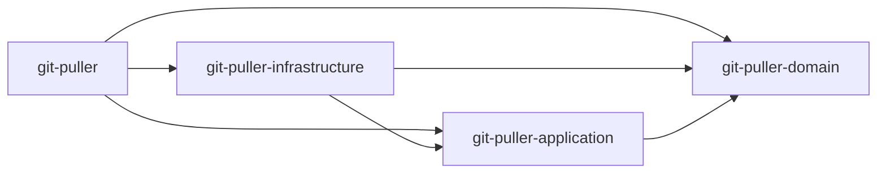

# git-puller

지정한 디렉터리 아래의 Git 작업 트리(worktree)를 재귀적으로 탐색해 병렬로 fast-forward 업데이트하고, 결과를 경로순으로 요약 출력하는 Haskell CLI 도구입니다.

## 주요 기능

- **재귀 탐색 및 안전 필터링**: `.git` 디렉터리·파일을 기준으로 작업 트리를 찾으며, 작업 트리를 찾으면 그 내부(중첩 저장소·서브모듈 포함)는 더 탐색하지 않습니다. 심볼릭 링크는 따라가지 않으며, bare 저장소는 제외하고 서브모듈과 변경·충돌 상태의 저장소는 안전하게 건너뜁니다.
- **fast-forward 전용 업데이트**: `git pull --ff-only --no-rebase --no-recurse-submodules`로만 갱신하며, 자식 Git 프로세스에서 저장소 재정의 환경변수(`GIT_DIR`, `GIT_WORK_TREE` 등)를 제거하고 `GIT_TERMINAL_PROMPT=0`, `GIT_OPTIONAL_LOCKS=0`을 강제합니다.
- **병렬 실행과 연결된 worktree 직렬화**: 디렉터리 탐색·저장소 검사·pull을 지정한 작업 수만큼 병렬로 수행하되, 같은 Git 공통 디렉터리를 공유하는 연결된 worktree의 pull은 서로 겹치지 않게 순차 실행합니다.
- **드라이런과 실시간 진행 표시**: `--dry-run`으로 원격 접근 없이 로컬 상태만 점검할 수 있고, 대화형 터미널에서는 `stderr` 상단에 진행률 표시줄을 출력합니다.
- **결정적인 경로순 출력**: 실행 순서와 무관하게 결과를 경로순으로 정렬해 출력하며, `UTF-8//ROUNDTRIP` 인코딩으로 비ASCII 및 특수 문자 경로를 무손실 처리합니다.

## 요구 사항

### 실행 환경

- **운영체제**: Linux, macOS 또는 Windows (네이티브)
- **Git**: `PATH`에서 실행 가능한 `git` 및 원격 저장소 인증 설정 (실제 업데이트 시)

### 빌드 및 개발 환경

- **GHC**: `9.10.3`
- **cabal-install**: `3.12` 이상 (CI 기준 `3.16`)
- **개발 도구** (`scripts/run.sh`, `scripts/format.sh` 사용 시): `fourmolu`, `stylish-haskell`, `hlint`

## 사용법

```text
git-puller [--dry-run] [--verbose] [--jobs <count>] <path>
git-puller --help
```

### 옵션

| 옵션 | 설명 | 기본값 |
| --- | --- | --- |
| `--dry-run` | 원격 fetch/pull 없이 로컬 상태만 검사하고 갱신 대상을 `planned`로 표시 | 미사용 |
| `--verbose` | 검사·pull·결과 로그와 진행 상황을 `stderr`로 실시간 출력 (`stdout`에는 요약만 출력) | 미사용 |
| `--jobs <count>` | 동시에 처리할 최대 작업 수 (양의 정수) | `16` |
| `--` | 옵션 구문 분석 종료 (`-`로 시작하는 경로 전달 시 사용) | - |
| `--help` | 사용법 출력 후 종료 (단독 사용) | - |

- 각 옵션은 순서에 관계없이 최대 한 번만 지정할 수 있습니다.
- `<path>`는 정확히 하나여야 하며, 심볼릭 링크가 아닌 읽을 수 있는 디렉터리여야 합니다.

### 실행 예시

```sh
# 기본 업데이트
git-puller ~/projects

# 로컬 상태만 사전 점검
git-puller --dry-run ~/projects

# 실시간 상세 로그 출력
git-puller --verbose ~/projects

# 동시 작업 수 지정
git-puller --jobs 8 ~/projects

# 하이픈(-)으로 시작하는 디렉터리 경로 전달
git-puller -- -projects
```

### 출력 형식

기본 실행에서는 모든 작업이 끝난 뒤 `stdout`에 경로별 결과를 경로순으로 출력합니다. ANSI를 지원하는 터미널에서는 상태별 건수와 전체 건수를 색상 표로 보여줍니다. 파일이나 파이프로 보내는 경우에는 아래와 같이 마지막에 요약 줄을 출력합니다. 발견된 작업 트리가 없으면 `No Git worktrees found.`를 출력합니다.

```text
updated "/home/user/projects/app"
planned "/home/user/projects/lib"
skipped "/home/user/projects/draft" dirty
failed "/home/user/projects/diverged" fatal: Not possible to fast-forward, aborting.
Summary updated=1 planned=1 skipped=1 failed=1
```

ANSI를 지원하는 터미널에 `stderr`가 연결되어 있으면 탐색 중에는 발견 수를, 처리 중에는 색상 막대와 완료 건수 및 백분율을 표시합니다. `NO_COLOR=1`을 설정하면 막대와 표를 색상 없이 표시합니다. `--verbose` 사용 시 개별 저장소의 `Inspecting`, `Pulling`, 처리 결과가 `stderr`에 실시간 기록되며, 실패 메시지는 따옴표로 이스케이프됩니다. `stderr`를 파일이나 파이프로 보내면 `--verbose` 진행 상태는 일반 텍스트로 기록됩니다.

#### 건너뛰기 사유 (`skipped`)

저장소는 아래 우선순위에 따라 검사되며, 조건에 해당하면 pull하지 않고 건너뜁니다.

| 사유 | 의미 |
| --- | --- |
| `submodule` | 상위 프로젝트(superproject)에 속한 서브모듈 |
| `unborn-branch` | 커밋이 아직 없는 초기 브랜치 |
| `merge-in-progress` | 병합 진행 중 (`MERGE_HEAD` 존재) |
| `rebase-in-progress` | 리베이스 진행 중 (`rebase-merge` 또는 `rebase-apply` 존재) |
| `detached-head` | 분리된 HEAD 상태 |
| `no-upstream` | 해석 가능한 업스트림 추적 브랜치 없음 |
| `dirty` | 스테이징·작업 트리 변경 사항 또는 추적되지 않은 파일 존재 |

### 종료 코드

| 코드 | 의미 |
| --- | --- |
| `0` | 실패 없이 완료 (건너뛰기·대상 없음·`--help` 포함) |
| `1` | 하나 이상의 경로에서 탐색·검사·pull 실패 |
| `2` | 시작 오류 (잘못된 인수, 유효하지 않은 시작 디렉터리, Git 실행 불가) |

## 빌드 및 개발

```sh
cabal update
cabal build all
cabal run git-puller -- --help
```

### 개발 스크립트

| 스크립트 | 설명 |
| --- | --- |
| `scripts/format.sh` | `packages`, `apps` 하위 모든 `.hs` 파일에 `fourmolu`와 `stylish-haskell` 적용 |
| `scripts/run.sh [인수...]` | 포맷 → `hlint packages apps` → `cabal build all` → `cabal test all` → CLI 실행 (인수 생략 시 `--help`) |
| `scripts/run.ps1 [인수...]` | PowerShell 래퍼 (Windows에서는 WSL을 통해, 그 외 환경에서는 직접 `scripts/run.sh` 실행) |

```sh
bash scripts/run.sh --dry-run ~/projects
```

## 테스트

전체 단위·통합·인수 테스트는 Cabal로 한 번에 실행합니다.

```sh
cabal test all
```

| 테스트 스위트 | 패키지 | 검증 대상 |
| --- | --- | --- |
| `domain-test` | `git-puller-domain` | `Discovery`·`Update` 상태 머신, `Repository.classify`, `Outcome` 집계 |
| `application-test` | `git-puller-application` | 순수 `Program` 해석기 기반 유스케이스 흐름 및 역할 라우팅 |
| `infrastructure-test` | `git-puller-infrastructure` | `BatchRunner`, `WorkerPool`, `Process`, `Git.childEnvironment`, `GitOutput`, `Descriptors` |
| `cli-unit-test` | `git-puller` | CLI 인수 파싱, 출력 렌더링, 진행률 상태 머신 |
| `cli-acceptance-test` | `git-puller` | `apps/git-puller/test/cli.sh` 기반 실제 로컬 Git 저장소·PTY 종단 간 검증 |

### 기준 구현과 출력 비교

다른 기준 실행 파일과 CLI 출력을 비교하려면 `REFERENCE_GIT_PULLER`에 기준 바이너리의 절대 경로를 지정해 `cli.sh`를 실행합니다.

```sh
REFERENCE_GIT_PULLER="/path/to/reference/git-puller" \
  bash apps/git-puller/test/cli.sh "$(cabal list-bin exe:git-puller)"
```

### 설치된 바이너리 스모크 테스트

```sh
bash apps/git-puller/test/installed.sh /usr/bin/git-puller
```

GitHub Actions(`.github/workflows/ci.yml`)는 `ubuntu-latest`와 `macos-latest`에서 GHC `9.10.3` / Cabal `3.16`으로 `cabal build all`과 `cabal test all`을 자동 검증합니다.

## 아키텍처 및 프로젝트 구조

[`cabal.project`](cabal.project)가 네 패키지를 하나의 워크스페이스로 묶습니다. 도메인과 애플리케이션은 상태와 실행 계획을 순수 함수로 계산합니다. 인프라가 파일시스템, Git 프로세스, 터미널, 동시성 처리를 맡고 CLI 실행 진입점이 각 계층을 조립합니다.



```text
.
├── cabal.project
├── packages/
│   ├── domain/          # git-puller-domain: 순수 도메인 모델 및 상태 머신
│   ├── application/     # git-puller-application: DCI 유스케이스, 역할 포트, 순수 Program AST
│   └── infrastructure/  # git-puller-infrastructure: 작업자 풀 해석기 및 Git/FS/프로세스/터미널 어댑터
├── apps/
│   └── git-puller/      # git-puller: CLI 라이브러리(인수·렌더링·진행률) 및 실행 진입점
└── scripts/             # 포맷, 개발 실행, 릴리스 패키징 스크립트
```

- **`packages/domain` (`git-puller-domain`)**
  - 부수효과가 없는 순수 도메인 모델입니다.
  - `Discovery`: 디렉터리 탐색 상태 머신(`Exploring | Complete`). 한 레벨의 목록 결과를 모아 다음 탐색 단계를 계산합니다.
  - `Repository`: 저장소 상태와 업데이트 가능 여부(`classify`), 건너뛰기 사유 우선순위를 정의합니다.
  - `Update`: `begin`이 경로와 실행 모드를 담은 검사 대기 상태를 만들거나 실패 결과를 확정합니다. 순수 전이 함수 `afterInspection`은 검사 대기 상태와 검사 결과를 받아 pull 대기 상태 또는 확정 결과를 반환합니다. `afterPull`은 pull 대기 상태와 pull 결과를 받아 최종 `Outcome`을 반환합니다. 각 전이 함수가 요구하는 대기 상태가 다르므로 검사 전에 pull 결과를 전달하면 컴파일 오류가 발생합니다.
  - `Outcome`: 경로별 결과를 집계하고(`summarize`), 배치에 실패가 있는지 판정합니다(`hasFailures`). CLI가 이 판정을 프로세스 종료 코드로 변환합니다.
- **`packages/application` (`git-puller-application`)**
  - DCI(Data, Context, Interaction) 구조로 유스케이스를 조합합니다.
  - Data는 도메인의 탐색 상태, 작업 트리 상태와 처리 결과입니다.
  - Context인 `UpdateWorktrees.start`는 탐색, 처리 대상 수 통지, 병렬 업데이트를 순서대로 기술하는 `Program` 값을 생성합니다.
  - Interaction인 `Survey`와 `Update`는 도메인 상태에 따라 역할에 보낼 요청을 선택합니다. `Surveyor`는 디렉터리를 읽고, `Inspector`는 저장소 상태를 확인하고, `Updater`는 pull을 수행하며, `Observer`는 진행 이벤트를 받습니다. `Roles.perform`이 각 요청을 `Cast`에 주입된 역할 구현에 전달합니다.
  - `Program`: GADT 기반 `Request`와 연속(`Await`, `Concurrently`, `Exclusively`)으로 동시성 및 공통 디렉터리 단위 상호 배제를 순수하게 기술합니다.
  - `Event`: 진행률과 상세 로그를 위한 애플리케이션 이벤트를 정의합니다.
- **`packages/infrastructure` (`git-puller-infrastructure`)**
  - `BatchRunner`는 전달받은 `Program`과 `Cast`를 실행합니다. `WorkerPool`이 동시 작업 수를 제한하고 `Exclusion`이 같은 Git 공통 디렉터리를 쓰는 pull을 직렬화합니다. `Git`·`Filesystem`·`Process`·`Terminal`이 외부 시스템과 통신합니다. 플랫폼별 구현은 `src-posix`·`src-windows`에서 Cabal 조건으로 선택됩니다.
  - 저장소 검사는 `git rev-parse`와 `git status --porcelain=v2 --branch` 출력의 순수 파서(`GitOutput`)로 처리합니다.
  - `Descriptors`가 시작 시 POSIX 환경에서 `RLIMIT_NOFILE` 소프트 한도를 작업 수에 맞는 값(`max 1024 (64 + 4 * jobs)`)으로 조정해 자식 프로세스 생성 시 `close_fds` 비용을 줄이고, `Encoding`이 무손실 UTF-8(`UTF-8//ROUNDTRIP`)을 설정합니다.
- **`apps/git-puller` (`git-puller`)**
  - 내부 라이브러리 `git-puller:cli`(`Cli.Arguments`, `Cli.Progress`, `Cli.Render`)가 옵션 해석, 진행률 상태 전이, 출력 포맷팅을 순수하게 처리하고, `app/Main.hs`가 어댑터를 조립해 실행합니다.

## 배포 및 패키징

릴리스 버전은 `apps/git-puller/git-puller.cabal`의 `version:` 필드에서 읽으며, 산출물은 기본적으로 `dist/` 디렉터리에 생성됩니다. 빌드된 바이너리는 빌드 호스트의 시스템 라이브러리(glibc 등)와 호환되는 환경에서 실행해야 합니다.

### Linux / macOS

GHC `9.10.3`, `cabal`, `fourmolu`, `stylish-haskell`이 필요합니다.

```sh
# Linux: .tar.gz, .deb, .rpm 생성 (dpkg, dpkg-deb, dpkg-shlibdeps, rpmbuild 필요)
# macOS: .tar.gz, .pkg 생성 (pkgbuild 필요)
bash scripts/release.sh

# tar.gz 번들만 생성
bash scripts/release.sh --bundle-only

# 출력 디렉터리 지정
bash scripts/release.sh installers ./out
```

### Windows

Windows 10/11, Windows용 GHC `9.10.3` 및 cabal(예: ghcup), Git for Windows, Inno Setup(`ISCC.exe`)이 필요합니다. WSL은 필요하지 않습니다.

```powershell
# 네이티브 git-puller.exe 빌드 후 .zip 및 Inno Setup 설치 프로그램(-setup.exe) 생성
.\scripts\release.ps1
```

설치 프로그램은 네이티브 `git-puller.exe`를 설치 디렉터리의 `bin`에 두고 이 디렉터리를 사용자 `PATH`에 등록합니다. 이전 WSL 기반 설치본의 런처와 `libexec`는 업그레이드 시 제거됩니다. 설치 후 새 터미널(PowerShell 또는 cmd)을 열고 Windows 경로를 전달해 실행합니다.

```powershell
git-puller --dry-run C:\Users\user\projects
```
